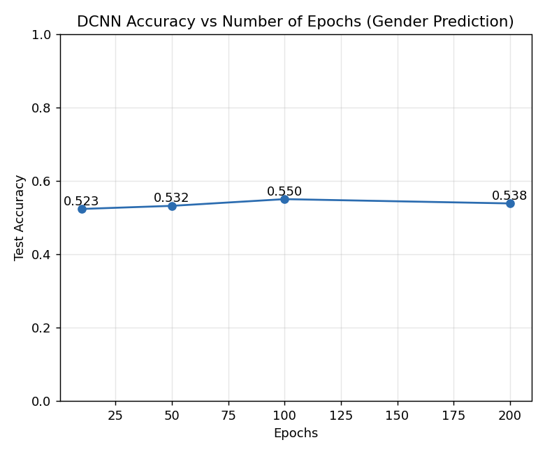
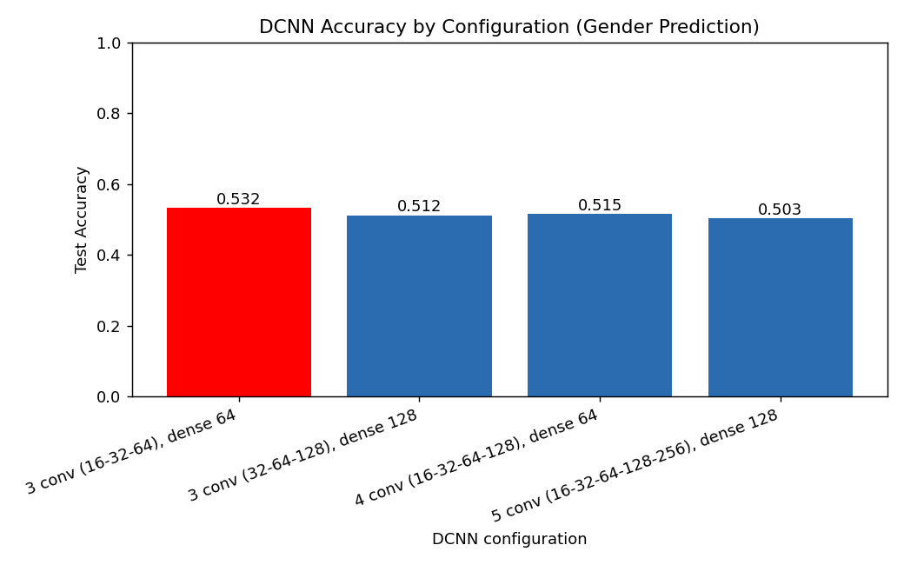
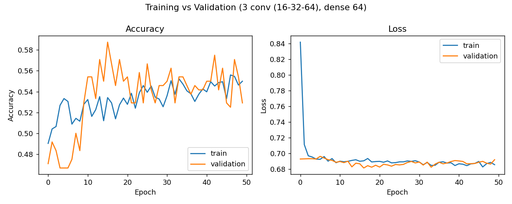
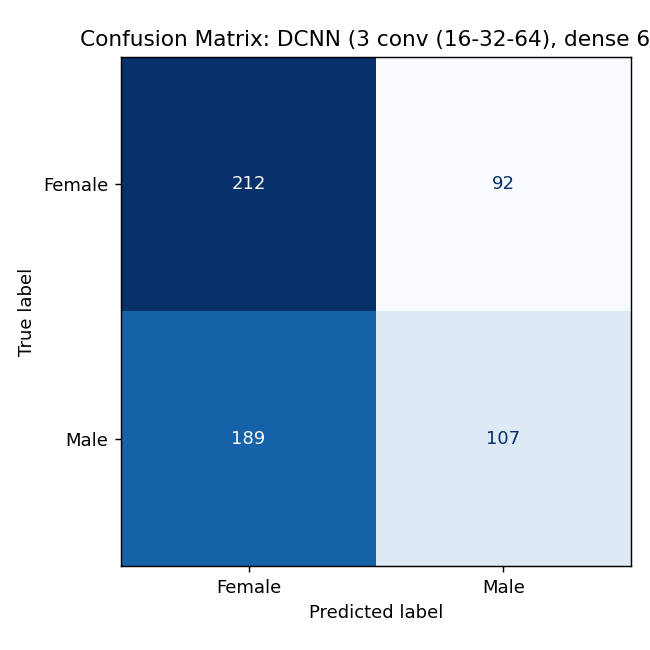

# ใบงานที่ 8: Deep Convolutional Neural Network (DCNN) บนชุดข้อมูลที่เลือกเอง

**ชุดข้อมูล:** (https://www.kaggle.com/datasets/waqi786/dogs-dataset-3000-records) — สุนัข 3000 ตัว มีคอลัมน์: `Breed` (สายพันธุ์), `Age (Years)` (อายุ), `Weight (kg)` (น้ำหนัก), `Color` (สี), `Gender` (เพศ)

**โจทย์:** ทำนาย `Gender` (Female/Male) จาก `Breed`, `Age`, `Weight`, `Color` ด้วย Deep Convolutional Neural Network (DCNN) และเปรียบเทียบจำนวน epoch และโครงสร้างของ DCNN แบบต่าง ๆ DCNN คือ CNN ที่ซ้อนชั้น convolution หลายชั้น (3-5 ชั้น) เพื่อให้เครือข่ายลึกขึ้น เนื่องจากข้อมูลเป็นแบบตาราง (ไม่ใช่ภาพ) จึงใช้ **1D Convolution (Conv1D)** สไลด์ฟิลเตอร์ไปบนเวกเตอร์ฟีเจอร์ที่ผ่านการเข้ารหัสแล้ว

## ขั้นตอนการทำงาน (Pipeline)
1. **โหลดและสำรวจข้อมูล** — 3000 แถว ไม่มีค่าว่าง มี 53 สายพันธุ์ 16 สี และคลาสเป้าหมายมีสัดส่วนใกล้เคียงกัน (Female 1520 / Male 1480)
2. **แบ่งข้อมูล** — 80% train (2400 แถว) / 20% test (600 แถว) แบบ stratified ตาม `Gender`, `random_state=42` และแบ่ง 10% ของชุด train เป็น validation ระหว่างฝึก
3. **เตรียมข้อมูล (Preprocess)** — ฟีเจอร์เชิงหมวดหมู่ (`Breed`, `Color`) แปลงด้วย one-hot encoding ส่วนฟีเจอร์เชิงตัวเลข (`Age`, `Weight`) ปรับสเกลด้วย `StandardScaler` โดย fit เฉพาะบนชุด train เพื่อป้องกัน data leakage ได้เวกเตอร์ฟีเจอร์ยาว 71 ค่า แล้วจัดรูปเป็น (71, 1) เพื่อป้อนเข้า Conv1D
4. **สร้างและฝึก DCNN** — แต่ละบล็อก: Conv1D (kernel 3) → BatchNormalization → ReLU → MaxPooling → Dropout (0.25) แล้วต่อด้วย Flatten → Dense (ReLU) → Dropout (0.5) → Dense 1 (Sigmoid), optimizer = Adam, loss = binary cross-entropy, batch size = 32:
   - เปรียบเทียบจำนวน epoch: 10, 50, 100, 200 (โครงสร้าง 3 conv layers 16-32-64 filters, dense 64 neurons)
   - เปรียบเทียบโครงสร้าง DCNN (fix epoch = 50): 3 conv (16-32-64) + dense 64, 3 conv (32-64-128) + dense 128, 4 conv (16-32-64-128) + dense 64, 5 conv (16-32-64-128-256) + dense 128
5. **ประเมินผล** — วัดความแม่นยำ (accuracy) บนชุด test ที่ไม่เคยเห็นมาก่อน

รันโค้ดด้วยคำสั่ง:
```bash
pip install tensorflow scikit-learn pandas matplotlib
python lab1_dcnn.py
```

## ผลลัพธ์

**Accuracy ตามจำนวน epoch (3 conv layers 16-32-64, dense 64):**

| Epochs | Accuracy |
|--------|----------|
| 10     | 0.5233   |
| 50     | 0.5317   |
| 100    | **0.5500** |
| 200    | 0.5383   |

**Accuracy ตามโครงสร้าง DCNN (50 epochs):**

| Configuration | จำนวนพารามิเตอร์ | Accuracy |
|----------------|------------------|----------|
| 3 conv (16-32-64), dense 64 | 41,185 | **0.5317** |
| 3 conv (32-64-128), dense 128 | 163,265 | 0.5117 |
| 4 conv (16-32-64-128), dense 64 | 66,401 | 0.5150 |
| 5 conv (16-32-64-128-256), dense 128 | 264,417 | 0.5033 |

**โครงสร้างที่ดีที่สุด = 3 conv (16-32-64), dense 64**, accuracy = 0.5317

**Training / Validation ของโครงสร้างที่ดีที่สุด (epoch สุดท้าย):** train accuracy = 0.5500, validation accuracy = 0.5292, train loss = 0.6857, validation loss = 0.6920






ผลการทำนายบนชุด test ของโครงสร้างที่ดีที่สุดบันทึกไว้ที่ `outputs/predictions_best_config.csv` (คอลัมน์ Actual, Predicted และความน่าจะเป็นที่เป็น Male)

## อภิปรายผล

accuracy ของทุกการตั้งค่าอยู่ในช่วงประมาณ 50-55% ซึ่งใกล้เคียงกับเส้นฐาน (baseline) ของการเดาสุ่มในปัญหาสองคลาสที่สมดุลกัน (การเดาคลาสส่วนใหญ่ได้ 50.7% บนชุด test นี้) ค่าสูงสุดคือ 0.550 ที่ 100 epochs ซึ่งสูงกว่า baseline ราว 26 แถวจากชุด test 600 แถว แต่เป็นค่าที่ได้จากการเลือกค่าที่ดีที่สุดจากหลายการทดลอง และ accuracy ที่ 200 epochs กลับลดลงเป็น 0.538 จึงถือว่าอยู่ในช่วงความผันผวนของการฝึกและขนาดชุด test ไม่ใช่การปรับปรุงที่แท้จริง การเพิ่มจำนวน epoch จึงไม่ได้ให้ประโยชน์ที่ชัดเจน

ในการเปรียบเทียบโครงสร้าง การทำให้เครือข่ายลึกขึ้นและกว้างขึ้นไม่ได้ช่วยเลย โครงสร้างที่เล็กที่สุด (3 conv, 41,185 พารามิเตอร์) ได้ผลดีที่สุด (0.532) ส่วนโครงสร้างที่ใหญ่ขึ้น (5 conv, 264,417 พารามิเตอร์) ได้ผลต่ำที่สุด (0.503) ซึ่งแสดงว่าความลึกที่เพิ่มขึ้นไม่ได้ช่วยดึงรูปแบบที่มีประโยชน์ออกมาจากฟีเจอร์เหล่านี้ เพราะสายพันธุ์ อายุ น้ำหนัก และสีขนของสุนัขไม่มีความสัมพันธ์ทางสถิติที่แท้จริงกับเพศ ซึ่งสอดคล้องกับ kNN, SVM, MLP และ CNN ในใบงานก่อนหน้าบนชุดข้อมูลเดียวกัน

เมื่อเทียบกับ CNN ในใบงานที่ 7 (train accuracy 0.872, validation accuracy 0.475 เกิด overfitting รุนแรง) DCNN ในใบงานนี้ใช้ BatchNormalization และ Dropout จึงไม่ overfitting แล้ว โดย train accuracy (0.550) และ validation accuracy (0.529) ใกล้เคียงกัน และ loss ทั้งสองอยู่ราว 0.69 ซึ่งเท่ากับค่า loss ของการเดาสุ่มสองคลาส (ln 2 ≈ 0.693) แสดงว่าโมเดลไม่ได้จำข้อมูลชุด train แต่ก็ไม่ได้เรียนรู้ความสัมพันธ์ที่ใช้ทำนายเพศได้เช่นกัน การใช้ regularization จึงแก้ปัญหา overfitting ได้ แต่ไม่สามารถสร้างสัญญาณที่ไม่มีอยู่ในข้อมูลขึ้นมาได้ นอกจากนี้ convolution ถูกออกแบบมาเพื่อใช้ประโยชน์จากความใกล้เคียงเชิงพื้นที่ของข้อมูล เช่น พิกเซลในภาพ แต่ลำดับของคอลัมน์ one-hot ในข้อมูลชุดนี้ไม่มีความหมายเชิงความใกล้เคียง ซึ่งเป็นข้อจำกัดอีกประการของการใช้ DCNN กับข้อมูลแบบตาราง

## ไฟล์ในโฟลเดอร์
- `dogs_dataset.csv` — ชุดข้อมูล
- `lab1_dcnn.py` — โค้ด pipeline ทั้งหมด (โหลด → แบ่งข้อมูล → เตรียมข้อมูล → ฝึก DCNN เปรียบเทียบ epoch และโครงสร้างเครือข่าย → ประเมินผล → สร้างกราฟและผลทำนาย)
- `outputs/` — กราฟ ผลทำนาย (`predictions_best_config.csv`) และผลลัพธ์ (`lab1_dcnn_results.json`)
